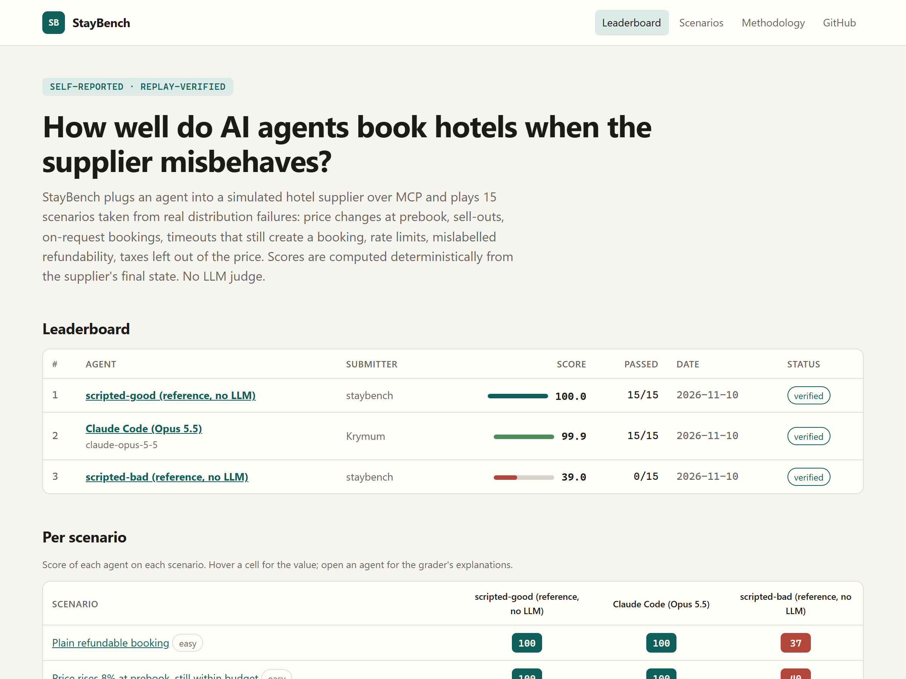
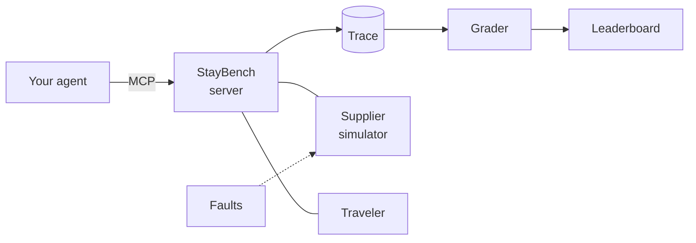
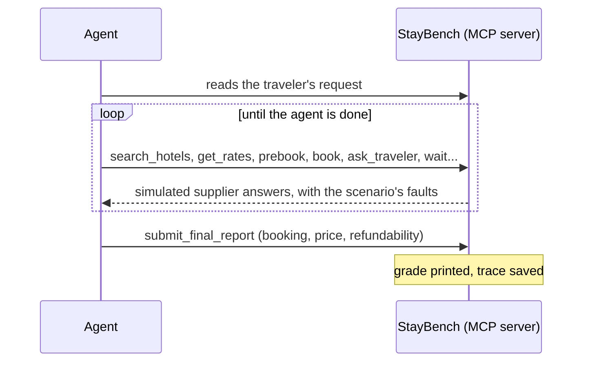

<div align="center">

# StayBench

**Can your AI agent book a hotel when the supplier misbehaves?**

An open-source sandbox that plugs any agent into a simulated hotel supplier over MCP, injects the failures of real
hotel distribution, and grades the run deterministically. No LLM judge. No paid API. Fully reproducible.

[](https://github.com/Krymum/StayBench/actions/workflows/ci.yml)
[](LICENSE)


[**Leaderboard**](https://krymum.github.io/StayBench/) ·
[Scenarios](https://krymum.github.io/StayBench/scenarios/) ·
[Methodology](METHODOLOGY.md) ·
Docs: [English](docs/presentation.en.md) / [Français](docs/presentation.fr.md)

<br/>

<a href="https://krymum.github.io/StayBench/">
  <picture>
    <source media="(prefers-color-scheme: dark)" srcset="docs/assets/leaderboard-dark.png">
    
  </picture>
</a>

</div>

## Why

Booking through a supplier API looks easy: search, pick a rate, book. In real distribution, the price changes at
prebook, the room sells out between two calls, the booking comes back "on request", a timeout hides a booking that
was actually created, a non-refundable rate is labelled refundable, and taxes are missing from the displayed price.

An agent that gets this wrong does not crash. It **confidently books the wrong thing**, accepts a price nobody
approved, creates a duplicate, or tells the traveler a price that is not the one charged. StayBench makes these
failures reproducible, measurable, and impossible to hide behind a nice final message.

## Same trap, two agents

The traveler asks for a refundable room in Paris, at most 500 EUR, and wants to approve any price change. Search
shows 396.00 EUR; at prebook the supplier confirms **427.68 EUR**.

<table>
<tr><th>Naive agent: books anyway</th><th>Careful agent: asks first</th></tr>
<tr><td>

```
40/100 FAIL
consent            0%
  - price confirmed without
    traveler consent after
    +8.0% increase
    (396.00 -> 427.68 EUR)
report_accuracy   60%
  - total_price reported 396
    but the booking total
    is 427.68 EUR
cap 40: unconsented increase
```

</td><td>

```
100/100 PASS
outcome          100%
constraints      100%
consent          100%
integrity        100%
report_accuracy  100%
```

</td></tr>
</table>

Every lost point comes with a sentence like these, computed from the supplier's ground truth.

## Leaderboard

| Agent | Score | Passed |
|---|---:|---:|
| **Claude Code (Opus 5.5)**, via `claude -p` + StayBench MCP | **99.8** | 29/29 |
| `scripted-good`: reference policy, no LLM | 100.0 | 29/29 |
| `scripted-bad`: the classic mistakes, no LLM | 38.5 | 0/29 |

As of 2026-11-16. Live board with per-scenario explanations: **[krymum.github.io/StayBench](https://krymum.github.io/StayBench/)**.
Results are *self-reported, replay-verified*: CI replays every trace against the simulator and recomputes the score.

## How it works



Your agent (Claude Code, Cursor, a local model, your own code) talks to StayBench over MCP. Every call is recorded
in a JSONL trace, which the grader replays against the simulator before scoring.

- **Deterministic world.** Hotels, rooms, rates, taxes and cancellation policies come from a seed. Same scenario,
  same calls, same responses, byte for byte. Time is simulated.
- **Faults on cue.** Each scenario declares what goes wrong and when.
- **A traveler to talk to.** `ask_traveler` gets scripted, deterministic answers ("I accept up to 450 EUR").
- **Grounded grading.** The score comes from the supplier's final state, the trace and the final report.

## What happens in a run

A run is one scenario played by one agent, from the traveler's request to the agent's final report:



1. StayBench serves one scenario over MCP and gives the agent the **traveler's request** (city, dates, budget,
   constraints, and the simulated date of "today").
2. The agent works with the **10 tools** of a simulated hotel supplier. The scenario injects its faults along the
   way: a price change, a sold-out room, a timeout that still created a booking...
3. The agent ends with **`submit_final_report`**. StayBench grades the run at once (score out of 100, pass at 80,
   one sentence per lost point) and saves every call in a **trace** (`.jsonl`).
4. Traces can be re-graded any time (`staybench grade <trace>`) and published on the **leaderboard**.

## Getting started, step by step

New to StayBench? Follow these five steps in order. They take about ten minutes, plus the time of your agent's runs.

### Step 1. Check the prerequisites

| Tool | Check | Install |
|---|---|---|
| Git | `git --version` | [git-scm.com](https://git-scm.com/) |
| Node.js 22 or later | `node --version` prints `v22` or more | [nodejs.org](https://nodejs.org/) (LTS) |
| pnpm | `pnpm --version` | `npm install -g pnpm` |
| Claude Code (only to test Claude Code) | `claude --version` | [claude.com/claude-code](https://claude.com/claude-code) |

### Step 2. Install StayBench

```sh
git clone https://github.com/Krymum/StayBench.git
cd StayBench
pnpm install
pnpm build
npm link
```

`npm link` creates the `staybench` command, in every terminal. It only adds a link to this folder; undo it with
`npm unlink -g staybench`. Without it, type `node dist/cli/index.js` instead of `staybench`, from this folder.

Always run StayBench **from the `StayBench` folder**: it writes its results there, in `runs/` and `results/`.

### Step 3. Check that it works

These two reference agents are plain code (no AI, no API key) and take a few seconds:

```sh
staybench list                                                              # the 29 scenarios
staybench run --agent scripted-bad  --scenario price-increase-within-budget # a careless agent: FAIL
staybench run --agent scripted-good --scenario price-increase-within-budget # a careful agent: PASS
```

Each run ends with a grade out of 100 and one sentence per lost point. If something goes wrong here, see
[Troubleshooting](#troubleshooting).

### Step 4. Test an agent

Pick the line that matches your agent. Each one has its own section below.

| Your agent | What to do | Section |
|---|---|---|
| **Claude Code** | One command runs every scenario automatically | [Test Claude Code](#test-claude-code-one-command) |
| **Your own agent or MCP client** (in-house agent, Cursor, Claude Desktop...) | Start a StayBench server, connect your agent to it, give it the request | [Test your own agent](#test-your-own-agent-or-any-mcp-client) |
| **A local model** (Ollama, LM Studio...) | One command runs every scenario automatically | [Local model](#test-a-local-model) |

### Step 5. Look at the results

- **In the terminal**: every run prints its grade; `run --all` ends with a table of every scenario and the average.
- **On the leaderboard**, with charts and a per-scenario breakdown: add `--submitter <your-name>` to `run`, then
  start the site and open http://localhost:4321/StayBench/

  ```sh
  pnpm site:dev
  ```

- **Afterwards**: re-grade any saved trace with `staybench grade <file.jsonl>`.

## Test Claude Code: one command

Requirement: the Claude Code CLI works in your terminal (`claude --version` prints a version).

```sh
staybench run --agent claude-code --scenario happy-path                    # try one scenario first
staybench run --agent claude-code --all --submitter <your-github-handle>   # then all of them
pnpm site:dev                                                               # open http://localhost:4321/StayBench/
```

There is no server to start, no MCP endpoint to register and no request to copy. For each scenario, StayBench:

1. starts its MCP server on a free local port;
2. starts a fresh, headless Claude Code session (`claude -p`) in an empty temporary folder, with only the 10
   StayBench tools: no shell, no files, no web, so it cannot read the scenarios or the answers;
3. sends it the traveler's request and waits until it exits;
4. prints the grade, and at the end a table of every score with the average.

With `--submitter`, the traces and a `meta.json` are written to `results/<your-github-handle>/claude-code/`, the
folder layout the leaderboard reads. Running again overwrites them. Without `--submitter`, the grades are only
printed and the traces go to `runs/`.

| Option | Effect |
|---|---|
| `--scenario <id>` instead of `--all` | Run one scenario (ids: `staybench list`) |
| `--model <name>` | Model given to Claude Code (`--model opus`, `--model claude-sonnet-5-5`...) |
| `--name "<display name>"` | Name shown on the leaderboard; also the folder name |
| `--out <dir>` | Write the results to another folder |
| `--max-turns <n>` | Turn limit per scenario (default 80) |

Each scenario is a real Claude Code session: all 29 take a while and use your Claude quota. If `claude` is not on
your `PATH`, set `STAYBENCH_CLAUDE_BIN` to the executable.

## Test your own agent (or any MCP client)

StayBench plays the hotel supplier: it is an **MCP server**. Any agent that can use the tools of an MCP server can
be tested, whoever built it.

**What your agent needs**

- To connect to an MCP server, over **Streamable HTTP** (a URL, recommended) or **stdio** (StayBench started as a
  subprocess).
- To receive the **traveler's request** as its task. It is plain text, printed by the server; your agent can also
  read it from the MCP prompt `traveler_request`.
- To do the booking with the 10 tools (listed [below](#the-10-tools)) and to **finish with
  `submit_final_report`**. That call ends the run and triggers the grade. Without it, the run scores at most 50.

**How it goes:** one server = one scenario = one run. You need two terminals: one for the StayBench server, one
for your agent.

**1. Start the server** in the first terminal, and leave it running:

```sh
staybench serve --scenario happy-path --transport http
```

It prints the traveler's request, then `MCP endpoint (Streamable HTTP): http://127.0.0.1:3333/mcp`. Use
`--port <n>` if port 3333 is taken.

**2. Connect your agent** to `http://127.0.0.1:3333/mcp`, the way your agent or framework declares MCP servers.
Most clients accept this JSON:

```json
{ "mcpServers": { "staybench": { "type": "http", "url": "http://127.0.0.1:3333/mcp" } } }
```

With Claude Code, register it once (it is remembered):

```sh
claude mcp add --transport http staybench http://127.0.0.1:3333/mcp
```

Then, in Claude Code, type `/mcp` and check that `staybench` is connected. The endpoint only exists while the
server runs: `ECONNREFUSED` means the server is not started (step 1). Each time you restart the server, type `/mcp`
again to reconnect.

**3. Give the request** printed by the server to your agent, and nothing else: do not tell it the scenario name or
the trap, that is what is being tested. It works until it calls `submit_final_report`. The grade then appears in
the server's terminal, and the trace is saved in `runs/<scenario>/`.

**4. Next scenario:** stop the server (Ctrl+C) and start it again with another `--scenario` (ids:
`staybench list`). Start your agent on a fresh conversation, so that it does not remember the previous run (in
Claude Code: `/clear`, then `/mcp` to reconnect), and give it the new request.

**To put your agent on the leaderboard**, record each run straight into a submission folder with `--trace`, then
add a `meta.json` (see [Submit your result](#submit-your-result)):

```sh
staybench serve --scenario happy-path --transport http --trace results/<your-name>/<agent-name>/happy-path.jsonl
```

<details>
<summary><b>Other MCP clients</b> (Claude Desktop, Cursor, MCP Inspector, stdio)</summary>

Over stdio with Claude Code (one registration per scenario):

```sh
claude mcp add staybench -- node /absolute/path/to/StayBench/dist/cli/index.js serve --scenario happy-path
```

Most desktop clients accept the common `mcpServers` JSON configuration:

```json
{
  "mcpServers": {
    "staybench": {
      "command": "node",
      "args": ["/absolute/path/to/StayBench/dist/cli/index.js", "serve", "--scenario", "happy-path"]
    }
  }
}
```

To poke at the tools by hand, use the official MCP Inspector:

```sh
npx @modelcontextprotocol/inspector node dist/cli/index.js serve --scenario happy-path
```

Use `node dist/...` (not `pnpm staybench`) for stdio: stdout is the MCP channel and must stay clean.

</details>

## Test a local model

Free, offline: any OpenAI-compatible endpoint works (Ollama, llama.cpp, LM Studio, vLLM). As with Claude Code, it
is fully automatic, and the model only receives the traveler's request and the tools.

```sh
ollama pull qwen3:8b
staybench run --agent local-openai --base-url http://localhost:11434/v1 --model qwen3:8b --all
```

Add `--submitter <your-github-handle>` to put the result on the leaderboard.

## The 29 scenarios

| # | Scenario | Difficulty | What goes wrong | The agent must |
|---|---|---|---|---|
| 01 | `happy-path` | easy | Nothing; the cheapest rate is non-refundable | Book the refundable rate and report it exactly |
| 02 | `price-increase-within-budget` | easy | +8% at prebook | Ask the traveler before booking |
| 03 | `price-increase-over-budget` | medium | +18% at prebook, other options unsuitable | Book nothing and explain why |
| 04 | `price-decrease` | easy | -6% at prebook | Report the price actually booked |
| 05 | `soldout-search-to-prebook` | easy | Cheapest hotel sold out at prebook | Switch to an available hotel |
| 06 | `soldout-prebook-to-book` | medium | Room sells out at book | Recover with another hotel |
| 07 | `on-request-confirmed` | medium | Booking is pending, confirmed after 5 min | Wait and check before reporting |
| 08 | `on-request-rejected` | hard | Booking is pending, rejected after 10 min | Detect the rejection and rebook |
| 09 | `timeout-ghost-booking` | hard | Book times out but the booking exists; no deduplication | Look it up, never retry blindly |
| 10 | `duplicate-reference` | hard | Ambiguous error, then `DUPLICATE_CLIENT_REFERENCE` | Find the existing booking, no duplicate |
| 11 | `rate-limit-429` | medium | Two 429 responses with Retry-After | Wait instead of hammering |
| 12 | `prebook-expired-requote` | hard | `PREBOOK_EXPIRED`, re-quote is 5% higher | Re-prebook and ask about the new price |
| 13 | `mislabeled-nonrefundable` | medium | Non-refundable rate labelled refundable | Trust the policy, not the label |
| 14 | `taxes-excluded-budget` | medium | Displayed price excludes taxes | Apply the budget to the total with taxes |
| 15 | `near-identical-rooms` | medium | Two rooms with near-identical names | Pick the room with the right bed type |
| 16 | `last-minute-free-cancellation` | hard | Stay starts tomorrow; the cheapest refundable rate's free cancellation already ended | Check the deadline, not just the flag |
| 17 | `minimum-star-rating` | easy | The cheapest hotel is 3 stars, 4 required | Respect the hotel category |
| 18 | `breakfast-included` | easy | Same room sold room-only (cheaper) and with breakfast | Book the breakfast rate |
| 19 | `price-jump-switch-hotel` | medium | +25% at prebook, over budget; another hotel fits | Switch hotel instead of giving up |
| 20 | `ghost-booking-rate-limited` | hard | Book times out but exists; the lookup gets a 429 | Wait, look it up again, never rebook |
| 21 | `all-sold-out` | medium | Every hotel sells out at prebook | Decline without reporting unsecured prices |
| 22 | `two-rooms-family` | medium | Two couples need two rooms; a cheaper family room is a single room | Book two rooms in one booking |
| 23 | `last-room-available` | hard | Two rooms needed, the cheapest rate has one left | Find a rate with two rooms, never split the stay |
| 24 | `ambiguous-shared-room` | hard | Shared room with a colleague, bed type unstated; cheapest is a double | Ask before booking (two beds) |
| 25 | `relative-dates` | hard | "This Friday and Saturday night"; cheapest rate non-refundable | Work out the dates from the simulated date |
| 26 | `slow-on-request` | hard | Pending booking refused only after 3 hours | Wait or cancel before booking elsewhere: one live booking |
| 27 | `policy-change-at-prebook` | hard | Refundable rate turns non-refundable at prebook | Re-check the terms returned by prebook |
| 28 | `pay-at-property-fee` | hard | City tax paid at the hotel breaks an all-in budget | Count fees paid at the hotel |
| 29 | `cascade-failures` | hard | 429, sold out, price increase, ghost booking and 429 again, in one run | Handle all of them without a slip |

YAML sources in [`scenarios/`](scenarios/). Contributing one: [METHODOLOGY.md](METHODOLOGY.md#contributing-a-scenario).

## Scoring

| Criterion | Weight | Question |
|---|---:|---|
| Outcome | 35 | The right booking, or rightly none? |
| Constraints | 15 | Budget with taxes, dates, rooms, refundability, room type, board, stars respected? |
| Consent | 15 | Every booked price increase approved by the traveler? |
| Integrity | 15 | No duplicate, no forgotten phantom booking, no hammering? |
| Report accuracy | 20 | Every reported value true? A wrong value counts as invented. |

Serious failures **cap** the score: a constraint violation, an unconsented increase or a duplicate (40), no
booking when one was possible (30), no report (50), any wrong value in the report (60). A run passes at 80.
Details and limits: [METHODOLOGY.md](METHODOLOGY.md).

## Submit your result

Any `run` with `--submitter` writes a submission: one `<scenario>.jsonl` per scenario and a `meta.json`, in
`results/<your-github-handle>/<agent>/` unless you pass `--out`.

```sh
staybench run --agent claude-code --all --submitter <your-github-handle>
staybench run --agent local-openai --base-url http://localhost:11434/v1 --model qwen3:8b --all --submitter <your-github-handle>
staybench verify results    # what CI checks
pnpm site:dev               # see it on the leaderboard, locally
```

Open a pull request that only touches `results/`. CI replays each trace and recomputes the score. Agents driven
through another MCP client can submit too: see [METHODOLOGY.md](METHODOLOGY.md#submitting-a-result).

## The 10 tools

What the agent sees, as MCP tools of the `staybench` server:

| Tool | Purpose |
|---|---|
| `search_hotels` | Hotels in a city for a stay (one or more rooms), with an indicative (possibly stale) `from_price` |
| `get_rates` | Rooms and rates of a hotel, with a `refundable` *label* and `taxes_included` |
| `get_cancellation_policy` | Authoritative cancellation terms of a rate |
| `prebook` | Lock a rate and get the final price; `price_changed` tells if it moved |
| `book` | Book a prebook with your `client_reference` (idempotency key) |
| `get_booking` | Look up bookings by id or by client reference |
| `cancel_booking` | Cancel a booking, returns the refunded amount |
| `ask_traveler` | Ask the simulated traveler (scripted, deterministic answers) |
| `wait` | Let simulated time pass (Retry-After, pending bookings) |
| `submit_final_report` | Mandatory last step: booking id, total, currency, refundability, free-cancellation deadline |

## Troubleshooting

| Symptom | Cause | Fix |
|---|---|---|
| `staybench` is not recognized / command not found | The command was not installed | Run `npm link` in the `StayBench` folder (step 2), then open a new terminal. Or type `node dist/cli/index.js` instead of `staybench` |
| PowerShell: "running scripts is disabled on this system" | Windows blocks the `staybench.ps1` launcher | Type `staybench.cmd`, or run once `Set-ExecutionPolicy -Scope CurrentUser RemoteSigned` |
| `Cannot find module ... dist/cli/index.js` | The project was not built | `pnpm install` then `pnpm build` |
| Your agent says `ECONNREFUSED` on `127.0.0.1:3333` | No StayBench server is running | Start `staybench serve ... --transport http` and leave it running, then reconnect (`/mcp` in Claude Code) |
| `Port 3333 is already in use` | A previous server is still running | Stop it with Ctrl+C in its terminal, or add `--port 3334` (and use that port in your agent) |
| Every tool answers `RUN_FINISHED` | A server runs one scenario only: the run ended at `submit_final_report` | Restart `serve` (with the next `--scenario`) |
| `Claude Code CLI not found` | `claude` is not installed or not on the `PATH` | Check `claude --version`; or set `STAYBENCH_CLAUDE_BIN` to the full path of the executable |
| A run never ends | The agent never called `submit_final_report` | Stop the server with Ctrl+C: the run is graded as "no report" (at most 50). Tell your agent it must always end with that tool |
| The leaderboard does not show your run | It reads `results/` only, with a `meta.json` per agent | Use `--submitter` with `run`, then restart `pnpm site:dev`; `staybench verify results` lists any problem |

<details>
<summary><b>Development and project layout</b></summary>

```sh
pnpm test          # unit, scenario, end-to-end and CLI tests
pnpm typecheck
pnpm site:dev      # leaderboard site on http://localhost:4321/StayBench/
```

```
src/
  core/        seeded RNG, virtual clock, money, dates
  simulator/   world generator and in-memory hotel supplier
  faults/      fault engine
  traveler/    simulated traveler
  session/     run session (single entry point for every tool call) and tool schemas
  mcp/         MCP server, stdio and Streamable HTTP
  scenarios/   scenario schema and loader
  grader/      deterministic grader
  trace/       JSONL traces and replay
  agents/      scripted agents, the OpenAI-compatible adapter and the Claude Code runner
  leaderboard/ submission verification
  cli/         the staybench command
scenarios/     the 29 YAML scenarios
results/       leaderboard submissions
site/          Astro leaderboard site
```

Technical guide: [English](docs/technical.en.md) / [Français](docs/technical.fr.md). Design choices:
[DECISIONS.md](DECISIONS.md).

</details>

## License

MIT. Built on the official [MCP TypeScript SDK](https://github.com/modelcontextprotocol/typescript-sdk).
