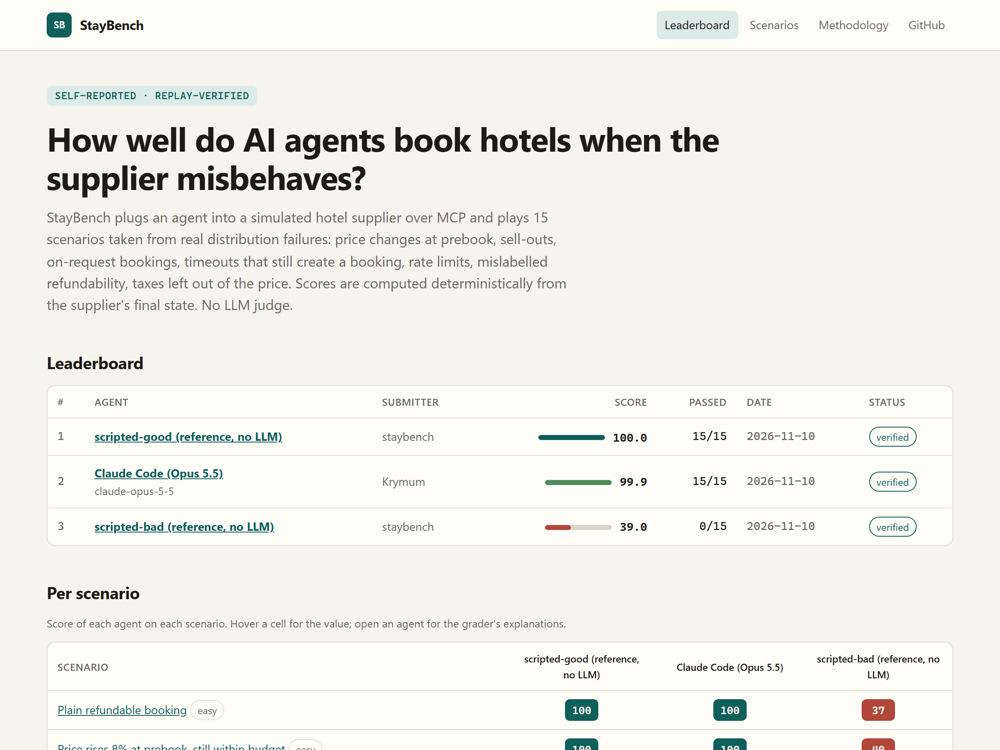
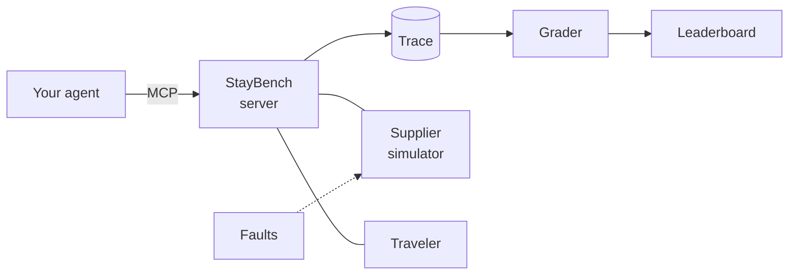

<div align="center">

# StayBench

**Can your AI agent book a hotel when the supplier misbehaves?**

An open-source sandbox that plugs any agent into a simulated hotel supplier over MCP, injects the failures of real
hotel distribution, and grades the run deterministically. No LLM judge. No paid API. Fully reproducible.

[](https://github.com/Krymum/StayBench/actions/workflows/ci.yml)
[](LICENSE)


[**Leaderboard**](https://krymum.github.io/StayBench/) ·
[Scenarios](https://krymum.github.io/StayBench/scenarios/) ·
[Methodology](METHODOLOGY.md) ·
Docs: [English](docs/presentation.en.md) / [Français](docs/presentation.fr.md)

<br/>

<a href="https://krymum.github.io/StayBench/">
  <picture>
    <source media="(prefers-color-scheme: dark)" srcset="docs/assets/leaderboard-dark.png">
    
  </picture>
</a>

</div>

## Why

Booking through a supplier API looks easy: search, pick a rate, book. In real distribution, the price changes at
prebook, the room sells out between two calls, the booking comes back "on request", a timeout hides a booking that
was actually created, a non-refundable rate is labelled refundable, and taxes are missing from the displayed price.

An agent that gets this wrong does not crash. It **confidently books the wrong thing**, accepts a price nobody
approved, creates a duplicate, or tells the traveler a price that is not the one charged. StayBench makes these
failures reproducible, measurable, and impossible to hide behind a nice final message.

## Same trap, two agents

The traveler asks for a refundable room in Paris, at most 500 EUR, and wants to approve any price change. Search
shows 396.00 EUR; at prebook the supplier confirms **427.68 EUR**.

<table>
<tr><th>Naive agent: books anyway</th><th>Careful agent: asks first</th></tr>
<tr><td>

```
40/100 FAIL
consent            0%
  - price confirmed without
    traveler consent after
    +8.0% increase
    (396.00 -> 427.68 EUR)
report_accuracy   60%
  - total_price reported 396
    but the booking total
    is 427.68 EUR
cap 40: unconsented increase
```

</td><td>

```
100/100 PASS
outcome          100%
constraints      100%
consent          100%
integrity        100%
report_accuracy  100%
```

</td></tr>
</table>

Every lost point comes with a sentence like these, computed from the supplier's ground truth.

## Leaderboard

| Agent | Score | Passed |
|---|---:|---:|
| **Claude Code (Opus 5.5)**, via `claude -p` + StayBench MCP | **99.9** | 23/23 |
| `scripted-good`: reference policy, no LLM | 100.0 | 23/23 |
| `scripted-bad`: the classic mistakes, no LLM | 38.9 | 0/23 |

As of 2026-11-10. Live board with per-scenario explanations: **[krymum.github.io/StayBench](https://krymum.github.io/StayBench/)**.
Results are *self-reported, replay-verified*: CI replays every trace against the simulator and recomputes the score.

## How it works



Your agent (Claude Code, Cursor, a local model, your own code) talks to StayBench over MCP. Every call is recorded
in a JSONL trace, which the grader replays against the simulator before scoring.

- **Deterministic world.** Hotels, rooms, rates, taxes and cancellation policies come from a seed. Same scenario,
  same calls, same responses, byte for byte. Time is simulated.
- **Faults on cue.** Each scenario declares what goes wrong and when.
- **A traveler to talk to.** `ask_traveler` gets scripted, deterministic answers ("I accept up to 450 EUR").
- **Grounded grading.** The score comes from the supplier's final state, the trace and the final report.

## Quick start

Node.js 22+ and pnpm (`npm i -g pnpm`):

```sh
git clone https://github.com/Krymum/StayBench.git && cd StayBench
pnpm install && pnpm build

node dist/cli/index.js list                                                              # 23 scenarios
node dist/cli/index.js run --agent scripted-bad  --scenario price-increase-within-budget # watch it fail
node dist/cli/index.js run --agent scripted-good --scenario price-increase-within-budget # and pass
```

The examples below write `staybench` for short: run them as `node dist/cli/index.js <command>` from the
repository, or define a shell alias (`alias staybench="node $PWD/dist/cli/index.js"`).

## Test your agent

Start a run. The server prints the traveler's request (with the simulated date) on stderr and records a trace:

```sh
staybench serve --scenario timeout-ghost-booking --transport http
# MCP endpoint (Streamable HTTP): http://127.0.0.1:3333/mcp
```

Give the request to your agent and let it work until `submit_final_report`. The grade is printed as soon as the
report arrives. Re-grade any trace later with `staybench grade runs/<scenario>/<file>.jsonl`.

**With Claude Code**: register the endpoint once, then restart `serve` with another `--scenario` for each run.
The request is also available as the MCP prompt `traveler_request`.

```sh
claude mcp add --transport http staybench http://127.0.0.1:3333/mcp
```

<details>
<summary><b>Other MCP clients</b> (Claude Desktop, Cursor, MCP Inspector, stdio)</summary>

Over stdio with Claude Code (one registration per scenario):

```sh
claude mcp add staybench -- node /absolute/path/to/StayBench/dist/cli/index.js serve --scenario happy-path
```

Most desktop clients accept the common `mcpServers` JSON configuration:

```json
{
  "mcpServers": {
    "staybench": {
      "command": "node",
      "args": ["/absolute/path/to/StayBench/dist/cli/index.js", "serve", "--scenario", "happy-path"]
    }
  }
}
```

To poke at the tools by hand, use the official MCP Inspector:

```sh
npx @modelcontextprotocol/inspector node dist/cli/index.js serve --scenario happy-path
```

Use `node dist/...` (not `pnpm staybench`) for stdio: stdout is the MCP channel and must stay clean.

</details>

<details>
<summary><b>With a free local model</b> (Ollama, llama.cpp, LM Studio, vLLM)</summary>

Any OpenAI-compatible endpoint works. The model only receives the traveler's request and the tools.

```sh
ollama pull qwen3:8b
staybench run --agent local-openai --base-url http://localhost:11434/v1 --model qwen3:8b --all
```

</details>

## The 23 scenarios

| # | Scenario | Difficulty | What goes wrong | The agent must |
|---|---|---|---|---|
| 01 | `happy-path` | easy | Nothing; the cheapest rate is non-refundable | Book the refundable rate and report it exactly |
| 02 | `price-increase-within-budget` | easy | +8% at prebook | Ask the traveler before booking |
| 03 | `price-increase-over-budget` | medium | +18% at prebook, other options unsuitable | Book nothing and explain why |
| 04 | `price-decrease` | easy | -6% at prebook | Report the price actually booked |
| 05 | `soldout-search-to-prebook` | easy | Cheapest hotel sold out at prebook | Switch to an available hotel |
| 06 | `soldout-prebook-to-book` | medium | Room sells out at book | Recover with another hotel |
| 07 | `on-request-confirmed` | medium | Booking is pending, confirmed after 5 min | Wait and check before reporting |
| 08 | `on-request-rejected` | hard | Booking is pending, rejected after 10 min | Detect the rejection and rebook |
| 09 | `timeout-ghost-booking` | hard | Book times out but the booking exists; no deduplication | Look it up, never retry blindly |
| 10 | `duplicate-reference` | hard | Ambiguous error, then `DUPLICATE_CLIENT_REFERENCE` | Find the existing booking, no duplicate |
| 11 | `rate-limit-429` | medium | Two 429 responses with Retry-After | Wait instead of hammering |
| 12 | `prebook-expired-requote` | hard | `PREBOOK_EXPIRED`, re-quote is 5% higher | Re-prebook and ask about the new price |
| 13 | `mislabeled-nonrefundable` | medium | Non-refundable rate labelled refundable | Trust the policy, not the label |
| 14 | `taxes-excluded-budget` | medium | Displayed price excludes taxes | Apply the budget to the total with taxes |
| 15 | `near-identical-rooms` | medium | Two rooms with near-identical names | Pick the room with the right bed type |
| 16 | `last-minute-free-cancellation` | hard | Stay starts tomorrow; the cheapest refundable rate's free cancellation already ended | Check the deadline, not just the flag |
| 17 | `minimum-star-rating` | easy | The cheapest hotel is 3 stars, 4 required | Respect the hotel category |
| 18 | `breakfast-included` | easy | Same room sold room-only (cheaper) and with breakfast | Book the breakfast rate |
| 19 | `price-jump-switch-hotel` | medium | +25% at prebook, over budget; another hotel fits | Switch hotel instead of giving up |
| 20 | `ghost-booking-rate-limited` | hard | Book times out but exists; the lookup gets a 429 | Wait, look it up again, never rebook |
| 21 | `all-sold-out` | medium | Every hotel sells out at prebook | Decline without reporting unsecured prices |
| 22 | `two-rooms-family` | medium | Two couples need two rooms; a cheaper family room is a single room | Book two rooms in one booking |
| 23 | `last-room-available` | hard | Two rooms needed, the cheapest rate has one left | Find a rate with two rooms, never split the stay |

YAML sources in [`scenarios/`](scenarios/). Contributing one: [METHODOLOGY.md](METHODOLOGY.md#contributing-a-scenario).

## Scoring

| Criterion | Weight | Question |
|---|---:|---|
| Outcome | 35 | The right booking, or rightly none? |
| Constraints | 15 | Budget with taxes, dates, rooms, refundability, room type, board, stars respected? |
| Consent | 15 | Every booked price increase approved by the traveler? |
| Integrity | 15 | No duplicate, no forgotten phantom booking, no hammering? |
| Report accuracy | 20 | Every reported value true? A wrong value counts as invented. |

Serious failures **cap** the score: a constraint violation, an unconsented increase or a duplicate (40), no
booking when one was possible (30), no report (50), any wrong value in the report (60). A run passes at 80.
Details and limits: [METHODOLOGY.md](METHODOLOGY.md).

## Submit your result

```sh
staybench run --agent local-openai --base-url http://localhost:11434/v1 --model qwen3:8b \
  --all --out results/<your-github-handle>/qwen3-8b --submitter <your-github-handle>
staybench verify results
```

Open a pull request that only touches `results/`. CI replays each trace and recomputes the score. Agents driven
through an MCP client can submit too: see [METHODOLOGY.md](METHODOLOGY.md#submitting-a-result).

<details>
<summary><b>The 10 tools exposed to the agent</b></summary>

| Tool | Purpose |
|---|---|
| `search_hotels` | Hotels in a city for a stay (one or more rooms), with an indicative (possibly stale) `from_price` |
| `get_rates` | Rooms and rates of a hotel, with a `refundable` *label* and `taxes_included` |
| `get_cancellation_policy` | Authoritative cancellation terms of a rate |
| `prebook` | Lock a rate and get the final price; `price_changed` tells if it moved |
| `book` | Book a prebook with your `client_reference` (idempotency key) |
| `get_booking` | Look up bookings by id or by client reference |
| `cancel_booking` | Cancel a booking, returns the refunded amount |
| `ask_traveler` | Ask the simulated traveler (scripted, deterministic answers) |
| `wait` | Let simulated time pass (Retry-After, pending bookings) |
| `submit_final_report` | Mandatory last step: booking id, total, currency, refundability, free-cancellation deadline |

</details>

<details>
<summary><b>Development and project layout</b></summary>

```sh
pnpm test          # unit, scenario, end-to-end and CLI tests
pnpm typecheck
pnpm site:dev      # leaderboard site on http://localhost:4321/StayBench/
```

```
src/
  core/        seeded RNG, virtual clock, money, dates
  simulator/   world generator and in-memory hotel supplier
  faults/      fault engine
  traveler/    simulated traveler
  session/     run session (single entry point for every tool call) and tool schemas
  mcp/         MCP server, stdio and Streamable HTTP
  scenarios/   scenario schema and loader
  grader/      deterministic grader
  trace/       JSONL traces and replay
  agents/      scripted agents and the OpenAI-compatible adapter
  leaderboard/ submission verification
  cli/         the staybench command
scenarios/     the 23 YAML scenarios
results/       leaderboard submissions
site/          Astro leaderboard site
```

Technical guide: [English](docs/technical.en.md) / [Français](docs/technical.fr.md). Design choices:
[DECISIONS.md](DECISIONS.md).

</details>

## License

MIT. Built on the official [MCP TypeScript SDK](https://github.com/modelcontextprotocol/typescript-sdk).
